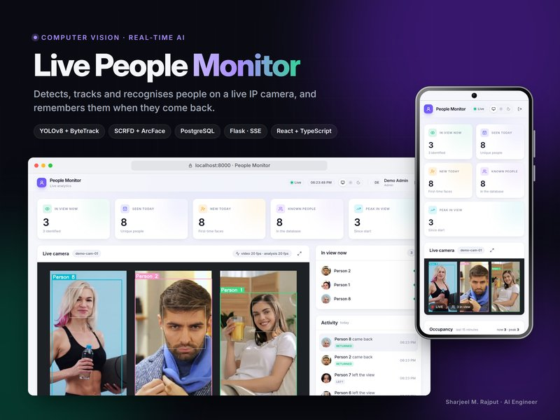
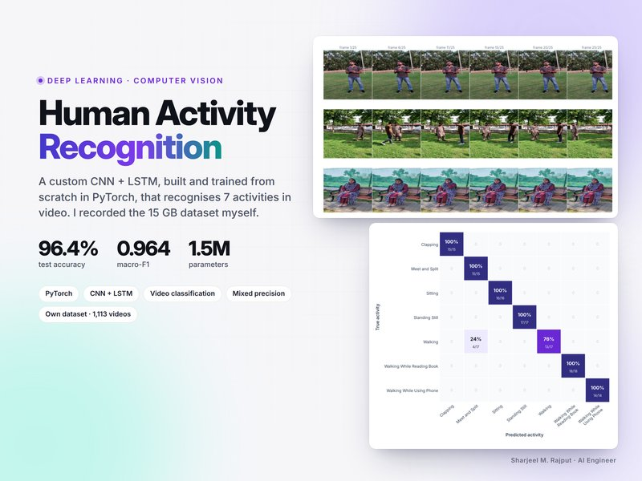
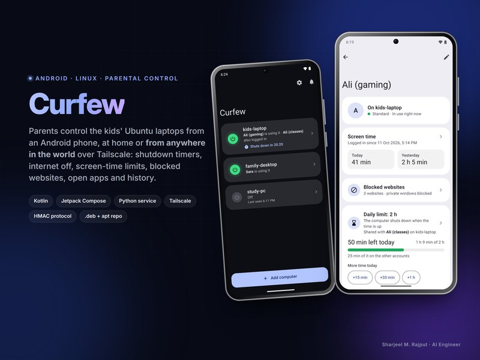
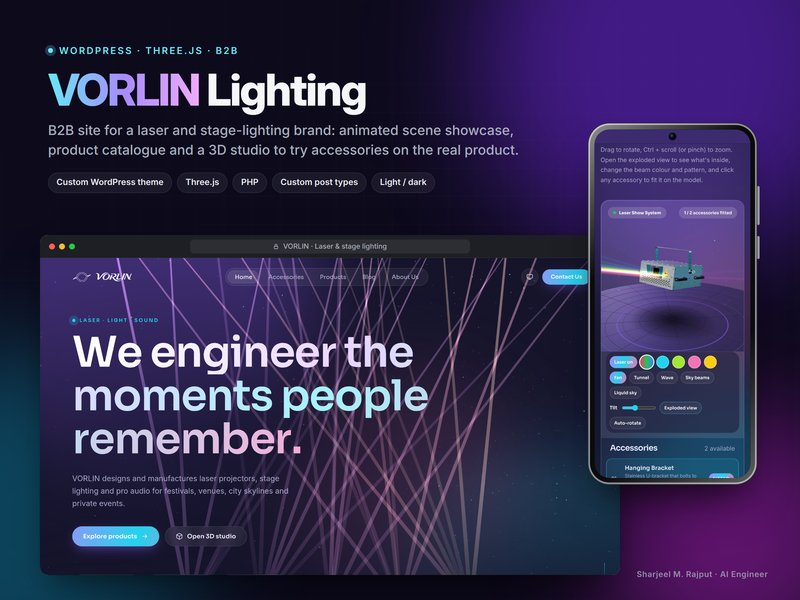
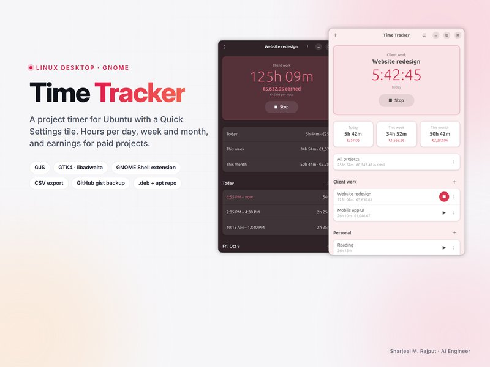
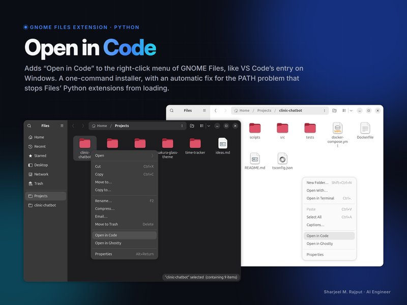
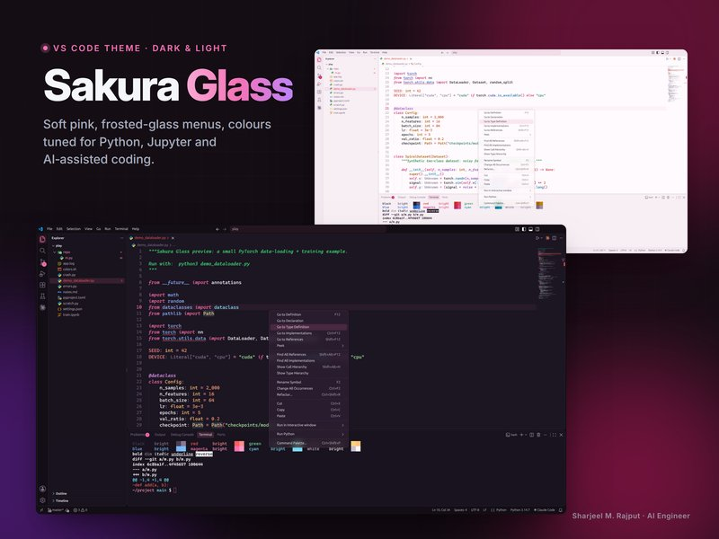

<h1 align="center">Hi 👋, I'm Sharjeel M. Rajput</h1>
<h3 align="center">AI Engineer · Computer Vision & Large Language Models</h3>

I build AI systems end to end: from the maths and the model to a service that keeps running on a real GPU. 
I like knowing <i>why</i> a model works, not only how to call it.

### 🔭 What I'm working on
- **Real-time computer vision on live video:** IP camera (RTSP) → YOLOv8 detection → ByteTrack tracking → SCRFD + ArcFace face recognition → PostgreSQL → live dashboard, on a single 5 GB GPU ([Live People Monitor](#featured-projects))
- **Deploying models, not just training them:** Linux services under systemd, GPU inference, reconnect logic, monitoring and clean handover
- **Video understanding:** a custom CNN + LSTM trained from scratch reaches 96.4% on unseen videos; I helped build the 15 GB human-activity video dataset behind it

### 🌱 What I'm learning
- **Transformers from first principles:** tokenization, embeddings, self-attention, training loops and evaluation, implemented by hand in PyTorch
- **The mathematics underneath:** linear algebra, calculus, probability, statistics and optimisation, so I can reason about models instead of treating them as black boxes
- Training small language models from scratch, then fine-tuning (LoRA/QLoRA) and RAG on open models

### 🚀 My goal
**To become an LLM researcher.** I want to work on how language models learn: architectures, training dynamics, scaling and honest evaluation.
Computer vision is my other love, and I enjoy shipping vision systems that work outside the notebook.

### 💬 Ask me about
Computer Vision · Object Detection & Tracking · Face Recognition · Video Understanding · PyTorch · Transformers · LLMs · Linux

### 📫 Reach me
**sharjeelmazhar@gmail.com**

<!-- projects:start -->
<h3 align="left" id="featured-projects">🧩 Featured projects</h3>
<table>
<tr><td width="50%" valign="top" align="center"> <b>Live People Monitor</b> Real-time person detection, tracking and face recognition on a live IP camera (YOLOv8, ByteTrack, SCRFD, ArcFace) <i>(private repo, demo on request)</i></td><td width="50%" valign="top" align="center"> <a href="https://github.com/rafay99-epic/human-activity-recognition-cnn-lstm"><b>Human Activity Recognition</b></a> Custom CNN + LSTM trained from scratch in PyTorch: 96.4% accuracy on unseen test videos <i>(final-year group project)</i></td></tr>
<tr><td width="50%" valign="top" align="center"> <a href="https://github.com/sharjeelmazhar/Curfew"><b>Curfew</b></a> Android app + Linux service to control the kids' Ubuntu laptops, at home or anywhere via Tailscale</td><td width="50%" valign="top" align="center"> <a href="https://github.com/sharjeelmazhar/phone-mic"><b>Phone Mic</b></a> Use an Android phone as a wireless microphone on any Linux PC (Kotlin, PipeWire, encrypted audio)</td></tr>
<tr><td width="50%" valign="top" align="center"> <b>Viral Clone</b> Generative AI video SaaS on 19 video, image and voice models, with a Windows app <i>(client project)</i></td><td width="50%" valign="top" align="center"> <b>VORLIN Lighting</b> B2B WordPress site with a real-time Three.js 3D product studio <i>(client project)</i></td></tr>
<tr><td width="50%" valign="top" align="center"> <a href="https://github.com/sharjeelmazhar/islam-and-science"><b>Islam & Science</b></a> Referenced, data-driven static site with interactive canvas visualisations</td><td width="50%" valign="top" align="center"> <a href="https://github.com/sharjeelmazhar/time-tracker"><b>Time Tracker</b></a> GNOME desktop app + Quick Settings tile; every change backed up, survives a reinstall</td></tr>
<tr><td width="50%" valign="top" align="center"> <a href="https://github.com/sharjeelmazhar/nautilus-open-in-code"><b>Open in Code</b></a> GNOME Files extension: right-click to open folders in VS Code</td><td width="50%" valign="top" align="center"> <b>Sakura Glass</b> Pink frosted-glass VS Code theme, dark and light, tuned for Python and Jupyter</td></tr>
</table>
<!-- projects:end -->

<h3 align="left">Connect with me:</h3>

<h3 align="left">Languages and Tools:</h3>

                    

&nbsp;

